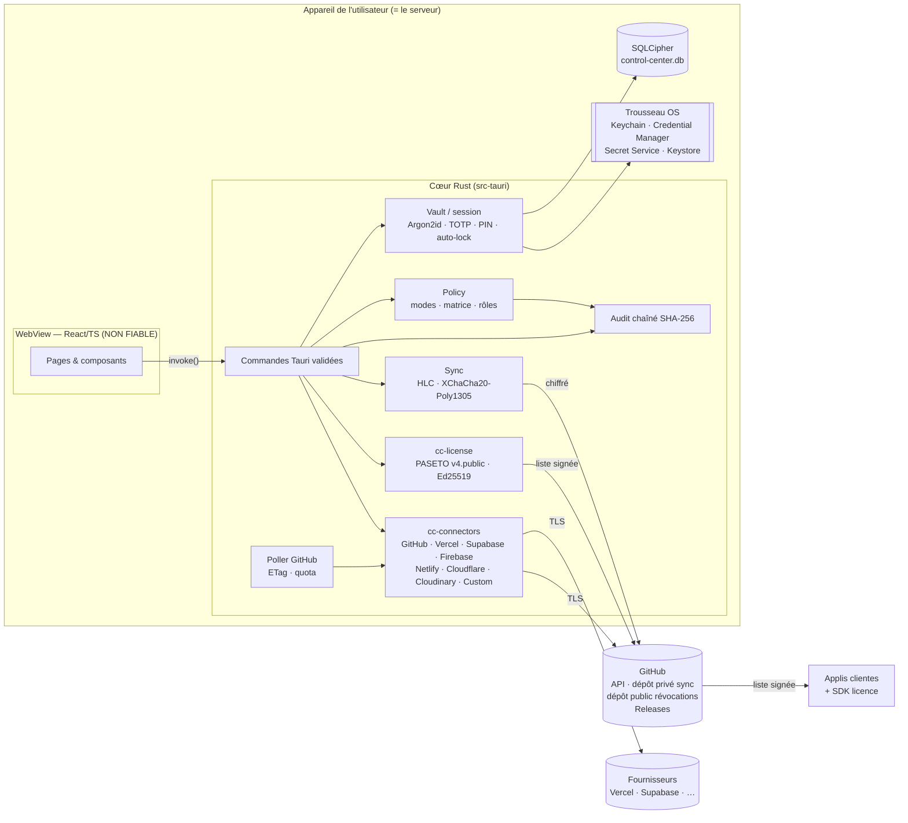
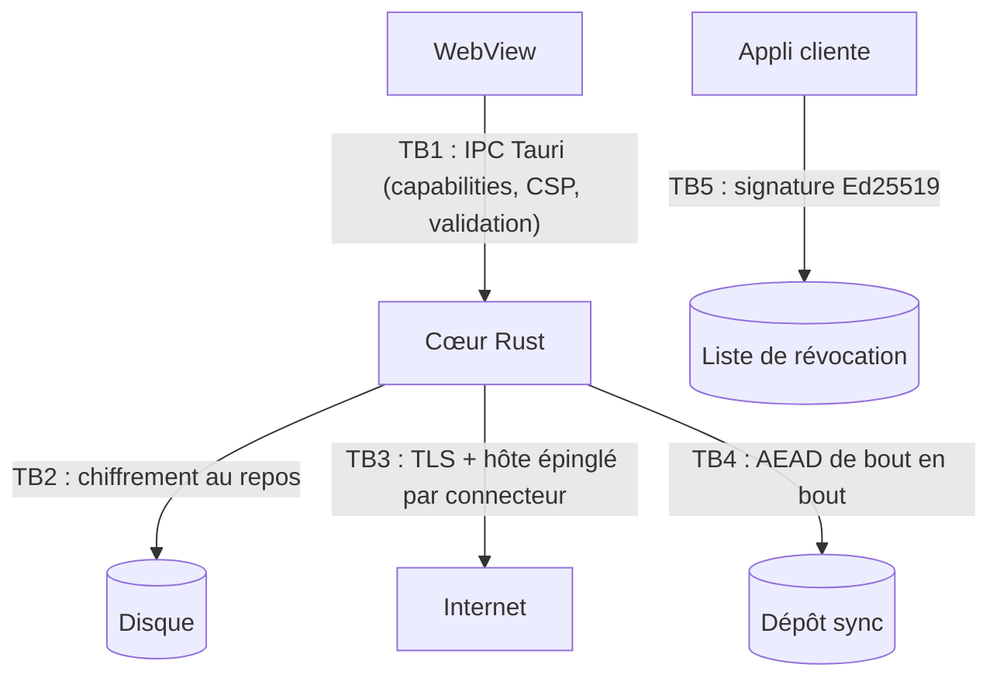

# Architecture — Control Center

## Vue d'ensemble

### Frontières de confiance

## Modules

| Module | Rôle | Dépend de |
|--------|------|-----------|
| `crates/core` (`cc-core`) | Modèles, stockage SQLCipher, migrations, crypto (Argon2id, XChaCha20-Poly1305, HMAC), vault/session, politique d'accès, audit, sync, export `.ccvault`, diff des variables | `cc-license` |
| `crates/license` (`cc-license`) | Clés Ed25519 + `kid`, émission/vérification PASETO v4.public, clé lisible, liste de révocation signée | — |
| `crates/connectors` (`cc-connectors`) | Trait `Connector`, client HTTP durci, un module par fournisseur, poller GitHub, transport de sync GitHub, conversion WebP | `cc-core` |
| `app/src-tauri` | Commandes Tauri, état applicatif, tâches de fond (auto-lock, polling, sync), notifications, updater | les 3 crates |
| `app/ui` | Interface React (affichage uniquement) | `@tauri-apps/api` |
| `sdk/ts`, `sdk/rust`, `sdk/go` | Vérification de licence dans les applis clientes | — |

## Flux de données clés

### Déverrouillage
1. L'interface envoie la phrase secrète (une seule fois) → `unlock`.
2. Rust lit `vault.json` (sel + paramètres Argon2id + vérificateur), dérive 32 octets, ouvre SQLCipher (`PRAGMA key = "x'…'"`).
3. Si TOTP actif : code exigé avant que la session ne passe à `Unlocked`.
4. La clé reste en mémoire (`Zeroizing`) jusqu'au verrouillage (manuel ou inactivité).

### Ajout d'un secret
UI → `secret_add(app, env, provider, name, value)` → Policy vérifie → valeur dans le trousseau (`cc:<secret_id>`) → métadonnées (`secrets_meta`) dans SQLCipher → audit. Réponse : métadonnées + masque.

### Action d'écriture chez un fournisseur
UI → `action_preview` (aperçu, jeton de confirmation à usage unique, 2 min) → `action_execute(token[, reauth])` → Policy (mode, matrice, rôle, ré-auth si destructif) → connecteur → audit.

### Synchronisation
Changement local → `sync_events` (HLC) → chiffrement → `events/<device>/<hlc>-<id>.ccev` dans le dépôt privé → autres appareils : listage, déchiffrement, fusion LWW par enregistrement (HLC + id appareil), conflits concurrents placés dans `sync_conflicts` pour résolution manuelle.

### Licences
Création → PASETO v4.public signé (clé privée du trousseau) + clé lisible HMAC → client. Révocation → nouvelle liste signée (`seq`+1) publiée dans le dépôt public → SDK la télécharge périodiquement, vérifie la signature et `seq`, applique un délai de grâce hors ligne.

## Décisions
Voir `PLAN.md` (section « Décisions d'architecture »).
