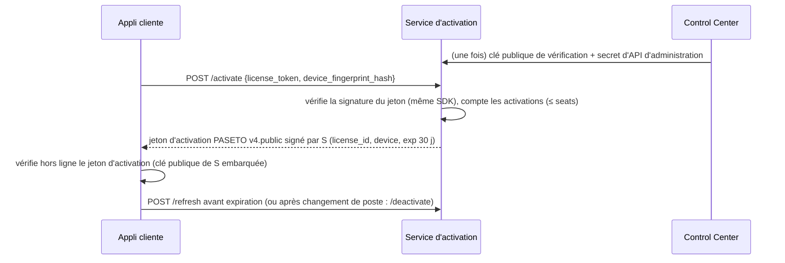

# Option future : service en ligne de limitation des activations

## Pourquoi

Les licences Control Center sont vérifiées **hors ligne** (signature Ed25519). C'est robuste et
sans serveur, mais une licence copiée peut être utilisée sur plusieurs machines tant qu'elle n'est
pas révoquée. Pour limiter **strictement** le nombre d'activations (ex. « 3 postes »), il faut un
tiers qui compte : un petit service en ligne.

## Conception proposée (minimale)

- **Données** : `license_id`, empreinte hachée de l'appareil (jamais d'identifiant brut), date.
  Aucune donnée client nominative n'est nécessaire.
- **Hébergement** : une fonction serverless (Cloudflare Workers + D1, Vercel + Postgres, ou
  Supabase Edge Function) suffit ; coût quasi nul à faible volume.
- **Sécurité** : TLS, limitation de débit par licence et par IP, signature des réponses
  (PASETO v4.public, clé dédiée distincte de la clé de licence), journal des activations,
  révocation synchronisée depuis la liste publique existante.
- **Mode dégradé** : si le service est injoignable, l'appli garde le jeton d'activation valide
  jusqu'à son expiration (même logique que le délai de grâce de la liste de révocation).
- **Intégration Control Center** : un connecteur « Service d'activation » (type personnalisé)
  pour consulter/annuler les activations depuis la fiche licence.

## Ce qui ne change pas

Le format des licences (PASETO v4.public, `kid`), la liste de révocation et les SDK restent
identiques : le service d'activation est une couche **en plus**, optionnelle par produit
(option `max_activations` dans les options de la licence).
