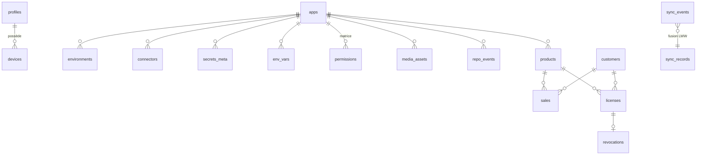

# Schéma SQLite (SQLCipher)

La source de vérité est `crates/core/migrations/*.sql`, appliquée au démarrage par
`cc_core::db::migrate` (numéro de version dans `PRAGMA user_version`, migrations
dans une transaction, jamais modifiées une fois publiées).

| Table | Contenu | Remarque sécurité |
|-------|---------|-------------------|
| profiles | profil local, réglages 2FA, dépôts | secret TOTP chiffré par SQLCipher |
| devices | appareils appairés, révocation | |
| roles | owner / admin / viewer | |
| apps | applications suivies + mode d'accès | |
| environments | development / preview / production | |
| connectors | fournisseur, config non secrète, référence de secret | |
| secrets_meta | **métadonnées** des secrets (4 derniers caractères, empreinte HMAC) | la valeur est dans le trousseau |
| env_vars | variables d'environnement par appli | valeurs sensibles = lien vers un secret |
| permissions | matrice d'actions par appli | |
| products, customers, sales | catalogue, clients, ventes | |
| licenses | jetons PASETO émis, clé lisible | jetons publics (signés), pas de secret |
| revocations, revocation_lists | révocations et listes signées publiées | `seq` monotone (anti-rollback) |
| media_assets | médias publiés | |
| repo_events, poll_state | événements GitHub, ETag | |
| sync_events, sync_records, sync_conflicts | journal, état fusionné, conflits | chiffrés avant envoi |
| audit_logs | journal chaîné SHA-256 | triggers : append-only |
| settings | réglages clé/valeur | |
